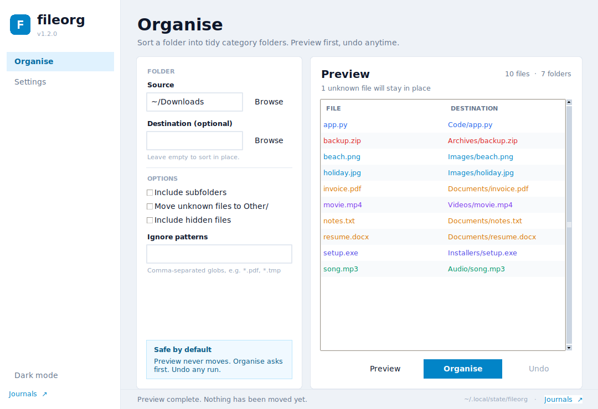
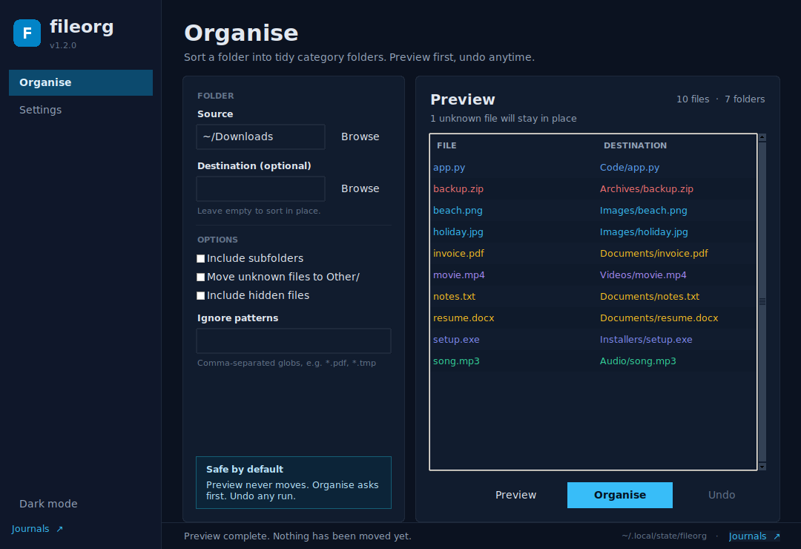

<p align="center"></p>

<h1 align="center">fileorg</h1>

<p align="center">A small, safe file organiser for Windows and Linux — desktop app and command line.</p>

<p align="center">
  <a href="https://github.com/hari1vkp/fileorg/releases/latest"></a>
</p>

<p align="center">
  <a href="https://github.com/hari1vkp/fileorg/actions/workflows/tests.yml"></a>
  <a href="https://github.com/hari1vkp/fileorg/actions/workflows/build-app.yml"></a>
  <a href="LICENSE"></a>
  
</p>

`fileorg` scans a folder (`~/Downloads` by default) and moves each file into a category
folder such as `Images/`, `Videos/`, `Documents/`, `Archives/` or `Code/`, based on its
extension. Preview everything first, never overwrite a file, and undo any run.



## Download the app

Grab the latest build from **[Releases](https://github.com/hari1vkp/fileorg/releases/latest)**:

| Platform | File | Run it |
| --- | --- | --- |
| Windows 10/11 (64-bit) | `fileorg-windows-x86_64.zip` | Extract, then double-click `fileorg.exe`. |
| Linux (x86_64) | `fileorg-linux-x86_64.tar.gz` | `tar -xzf fileorg-linux-x86_64.tar.gz && ./fileorg` |

Both builds are portable — no installer, no Python, no dependencies. The Linux build is
produced on Ubuntu 22.04, so it needs glibc 2.35 or newer. The binaries are unsigned, so
Windows SmartScreen may ask for confirmation the first time.

## Desktop app



- Pick a source folder and an optional destination.
- Preview a table of every planned move before anything happens.
- Toggle subfolders, unknown files, hidden files and ignore patterns.
- **Organise** moves the files and writes an undo journal.
- **Undo** restores everything and cleans up the emptied category folders.
- Choose a light or dark theme; the app remembers it, along with your last folder and
  options, in `settings.json`.
- Long scans, moves and undos run on a worker thread, so the window never freezes.

The app and CLI share the same journal folder, so a run started in one can be undone in
the other.

## Run from source

The desktop app needs Python 3.9+ with Tkinter (included in the official Windows and
macOS installers, and in the `python3-tk` package on Debian/Ubuntu).

```bash
git clone https://github.com/hari1vkp/fileorg.git
cd fileorg
python3 main.py                 # launch the desktop app
python3 main.py ~/Downloads     # open with a folder already selected
```

No runtime packages to install. Build tooling is listed in `requirements.txt`.

## How a run works

```
main.py → app.application
  └─ builds the root window, theme manager, services and controller
       │
       ▼
   Dashboard  ──►  controller.preview()
       │              └─ service.preview() on a worker thread
       │                   └─ core.planner.build_moves()  (no disk writes)
       ▼
   Preview table  ◄──  controller marshals the plan back with after()
       │
       ▼
   Organise  ──►  confirmation dialog
       │
       ├─ service.organise() → core.fileops.apply_moves()
       │     mkdir category folders · shutil.move · never overwrite
       │     journal every successful move
       ▼
   Journal in the platform state folder
       │
       ▼
   Undo  ──►  service.undo() → put files back → prune empty folders
```

The Tk main loop only ever renders. Worker threads hand results to a queue that is
drained by `after()` on the main thread, so widgets are touched from one thread only.

## Architecture

```
.
├── main.py                     # desktop entry point
├── fileorg.py                  # CLI entry point (thin wrapper over app.cli)
├── requirements.txt            # build/dev tooling only
│
├── app/
│   ├── application.py          # composition root
│   ├── config.py               # platform paths, bundled asset resolution
│   ├── cli.py                  # argparse CLI built on the service
│   │
│   ├── core/                   # pure domain code, no Tk imports
│   │   ├── constants.py        # categories, version, design tokens
│   │   ├── exceptions.py       # user-facing domain errors
│   │   ├── events.py           # small event bus
│   │   ├── planner.py          # scan + plan moves
│   │   ├── fileops.py          # move, undo, prune
│   │   └── journal.py          # journal read/write
│   │
│   ├── models/                 # data only
│   │   ├── organise.py         # Move, options, plan, result
│   │   ├── settings.py         # persisted preferences
│   │   └── forms.py            # dashboard form state
│   │
│   ├── services/               # application operations
│   │   ├── organise_service.py # preview / organise / undo
│   │   └── settings_service.py # load / save settings
│   │
│   ├── controllers/
│   │   └── main_controller.py  # state, validation, threading
│   │
│   ├── ui/
│   │   ├── windows/main_window.py
│   │   ├── layouts/            # sidebar + shell
│   │   ├── views/              # dashboard, settings
│   │   ├── components/         # buttons, inputs, cards, dialogs, nav
│   │   └── themes/             # palettes, type scale, ttk styles, manager
│   │
│   ├── utils/                  # helpers and task runners
│   └── assets/                 # icons, screenshots, fonts
│
├── tests/                      # core, service, model and controller tests
└── scripts/make_icons.py       # regenerate committed icons
```

| Layer | Responsibility | May import |
| --- | --- | --- |
| `core` | Planning, moving, journalling | stdlib, models |
| `models` | Data structures | stdlib |
| `services` | Validate inputs, coordinate core | core, models, config |
| `controllers` | UI state and background work | services, models, theme manager, utils |
| `ui` | Widgets, layout, rendering | models, components, themes |
| `application` | Wiring only | everything |

UI never scans or moves files directly; controllers never import `tkinter` widgets.

## Theme system

`app/ui/themes/` is the single source of visual truth:

- `colors.py` holds two complete semantic palettes (`light`, `dark`).
- `typography.py` detects an installed UI font and exposes one type scale.
- `styles.py` builds every ttk style from the active palette.
- `theme_manager.py` owns the active theme and repaints registered widgets.

Screens refer to roles (`surface`, `border`, `muted`, `danger`) rather than hex values.
Components register themselves, so switching themes updates labels, cards, the table and
its category colours immediately. Window geometry, spacing tokens (`SPACE`) and corner
radii (`RADII`) live in `core/constants.py`.

## Safety notes

- `fileorg` **moves** files; it does not copy them. `shutil.move` handles cross-device moves.
- Preview never changes anything.
- Existing files are never overwritten — a numbered suffix is added instead.
- Hidden files and symlinks are skipped by default.
- Already-organised category folders are not walked again in recursive mode.
- Every organise run writes a journal, and Undo restores the files and removes the
  category folders it emptied.

## Command line

The CLI is still a single entry point with the same options and no dependencies.

```bash
python3 fileorg.py            # preview what would happen in ~/Downloads
python3 fileorg.py --apply    # move the files
```

```console
$ python3 fileorg.py
fileorg 1.2.0 - /home/you/Downloads (dry run)

  Archives/    1 file
  Audio/       1 file
  Code/        1 file
  Documents/   3 files
  Images/      2 files
  Installers/  1 file
  Videos/      1 file

  1 unrecognised file left in place (use --move-unknown).

Would move 10 files. Re-run with --apply to do it.
```

### Options

| Option | Description |
| --- | --- |
| `SOURCE` | Folder to organise. Defaults to `~/Downloads`. |
| `-d, --dest DIR` | Put the category folders somewhere else (another drive, for example). |
| `-n, --apply` | Actually move files. Without this, `fileorg` only prints a plan. |
| `-r, --recursive` | Also organise files inside subfolders. |
| `-u, --move-unknown` | Move unknown extensions into `Other/` instead of leaving them. |
| `--include-hidden` | Include dotfiles and hidden folders. |
| `--ignore PATTERN` | Skip names matching a glob. Repeatable. |
| `--undo` | Reverse the most recent run (preview unless combined with `--apply`). |
| `--journal FILE` | Undo a specific journal instead of the latest one. |
| `--state-dir DIR` | Store journals in `DIR` instead of the platform default. |
| `-v, --verbose` | Print every file as it is handled. |
| `--version` | Print the version. |

### Examples

```bash
# Organise a folder other than Downloads
python3 fileorg.py ~/Desktop --apply

# Include subfolders, but leave PDFs where they are
python3 fileorg.py ~/Downloads --recursive --ignore "*.pdf" --apply

# Sort onto another drive without touching the originals' names
python3 fileorg.py ~/Downloads --dest /mnt/storage/Sorted --apply

# Also file away unknown extensions
python3 fileorg.py ~/Downloads --apply --move-unknown
```

## Where files go

| Folder | Extensions (examples) |
| --- | --- |
| `Images/` | jpg, jpeg, png, gif, svg, webp, heic, avif, raw, cr2, nef, dng |
| `Videos/` | mp4, mkv, mov, avi, webm, m4v, mpg, mts, 3gp |
| `Audio/` | mp3, wav, flac, aac, ogg, m4a, opus, aiff, midi |
| `Documents/` | pdf, doc, docx, txt, rtf, odt, md, epub, tex |
| `Spreadsheets/` | xls, xlsx, csv, tsv, ods, numbers |
| `Presentations/` | ppt, pptx, odp, key |
| `Archives/` | zip, rar, 7z, tar, gz, xz, iso, dmg |
| `Installers/` | exe, msi, deb, rpm, apk, pkg, appimage |
| `Code/` | py, js, ts, html, css, json, yaml, sh, c, cpp, java, go, rs, sql |
| `Fonts/` | ttf, otf, woff, woff2 |
| `Design/` | psd, ai, xcf, fig, sketch |
| `3D/` | obj, fbx, stl, glb, gltf, blend |

Anything else stays where it is, unless you pass `--move-unknown`, in which case it goes
to `Other/`. The full mapping lives in [`app/core/constants.py`](app/core/constants.py)
and is easy to edit.

## Undo and journals

Each organise run writes a journal to:

| Platform | Journal location |
| --- | --- |
| Linux | `~/.local/state/fileorg/` (or `$XDG_STATE_HOME/fileorg`) |
| Windows | `%LOCALAPPDATA%\fileorg\` |
| macOS (CLI) | `~/Library/Application Support/fileorg/` |

```bash
python3 fileorg.py --undo           # preview the restore
python3 fileorg.py --undo --apply   # restore the files
```

Undo moves the files back, removes the category folders it emptied, and marks the
journal as `.undone` so the next `--undo` targets the run before it. The desktop app's
**Undo** button does the same thing.

Settings are stored separately:

| Platform | Settings location |
| --- | --- |
| Linux | `~/.config/fileorg/settings.json` (or `$XDG_CONFIG_HOME/fileorg/`) |
| Windows | `%APPDATA%\fileorg\settings.json` |
| macOS | `~/Library/Application Support/fileorg/settings.json` |

## Tech stack

| Layer | Choice | Why |
| --- | --- | --- |
| Language | Python 3.9+ | Same code on both operating systems. |
| Core | Standard library (`pathlib`, `shutil`, `json`, `argparse`) | Zero runtime dependencies, easy to audit. |
| Desktop UI | Tkinter + `ttk`, custom themed components | Ships with Python; small, portable binaries. |
| Architecture | Core → services → controllers → views | Business logic stays out of widgets. |
| Theming | Semantic palettes + ttk style factory | One design system, light and dark, no scattered hex codes. |
| Concurrency | `threading` + queue drained by `after()` | Slow disks never block the event loop. |
| Packaging | PyInstaller 6, one-file, windowed | Single executable per platform, no installer. |
| Builds | GitHub Actions on `ubuntu-22.04` and `windows-latest` | Native, reproducible builds; older glibc for Linux reach. |
| Icons | Pillow (development only) | Generates the committed PNG/ICO assets. |
| Tests | `unittest` | 47 tests across core, CLI, services, models and the controller. |

## Development

Run the test suite:

```bash
python3 -m unittest discover -s tests -v
```

Check imports and byte-compile everything:

```bash
python3 -m compileall -q app main.py fileorg.py
ruff check app main.py fileorg.py tests scripts --select E9,F63,F7,F82,F401,F811,F841
```

Build a local executable:

```bash
python3 -m pip install -r requirements.txt
python3 -m PyInstaller --noconfirm --clean fileorg.spec
./dist/fileorg
```

Regenerate icons after changing the design:

```bash
python3 scripts/make_icons.py
```

The core tests cover dry runs, category placement, collisions, hidden files, symlinks,
recursive runs, custom destinations, ignores and undo. Service, model and controller
tests cover validation, journal compatibility, settings persistence, threading
boundaries and state changes.

## License

[MIT](LICENSE)
