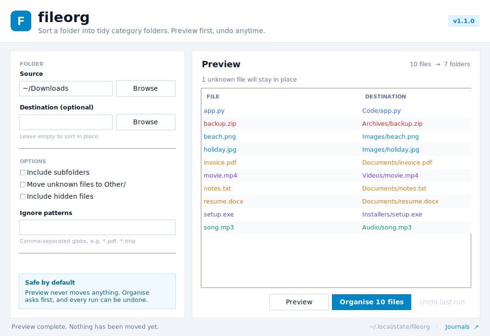

<p align="center"></p>

<h1 align="center">fileorg</h1>

<p align="center">A small, safe file organiser for Windows and Linux — desktop app and command line.</p>

<p align="center">
  <a href="https://github.com/hari1vkp/fileorg/releases/latest"></a>
</p>

<p align="center">
  <a href="https://github.com/hari1vkp/fileorg/actions/workflows/tests.yml"></a>
  <a href="https://github.com/hari1vkp/fileorg/actions/workflows/build-app.yml"></a>
  <a href="LICENSE"></a>
  
</p>

`fileorg` scans a folder (`~/Downloads` by default) and moves each file into a category
folder such as `Images/`, `Videos/`, `Documents/`, `Archives/` or `Code/`, based on its
extension. Preview everything first, never overwrite a file, and undo any run.



## Download the app

Grab the latest build from **[Releases](https://github.com/hari1vkp/fileorg/releases/latest)**:

| Platform | File | Run it |
| --- | --- | --- |
| Windows 10/11 (64-bit) | `fileorg-windows-x86_64.zip` | Extract, then double-click `fileorg.exe`. |
| Linux (x86_64) | `fileorg-linux-x86_64.tar.gz` | `tar -xzf fileorg-linux-x86_64.tar.gz && ./fileorg` |

Both builds are portable — no installer, no Python, no dependencies. The Linux build is
produced on Ubuntu 22.04, so it needs glibc 2.35 or newer. The binaries are unsigned, so
Windows SmartScreen may ask for confirmation the first time.

## Desktop app

The app is a thin Tkinter front end around the same tested core as the CLI.

- Pick a source folder and an optional destination.
- Preview a table of every planned move before anything happens.
- Toggle subfolders, unknown files, hidden files and ignore patterns.
- One **Organise** button moves the files and writes an undo journal.
- **Undo last run** restores everything and cleans up empty folders.

The app uses the same journal folder as the CLI, so a run started in one can be undone in
the other.

## Command line

The original single-file CLI is still there and has no dependencies.

```bash
git clone https://github.com/hari1vkp/fileorg.git
cd fileorg

python3 fileorg.py            # preview what would happen in ~/Downloads
python3 fileorg.py --apply    # move the files
```

```console
$ python3 fileorg.py
fileorg 1.1.0 - /home/you/Downloads (dry run)

  Archives/    1 file
  Audio/       1 file
  Code/        1 file
  Documents/   3 files
  Images/      2 files
  Installers/  1 file
  Videos/      1 file

  1 unrecognised file left in place (use --move-unknown).

Would move 10 files. Re-run with --apply to do it.
```

### Options

| Option | Description |
| --- | --- |
| `SOURCE` | Folder to organise. Defaults to `~/Downloads`. |
| `-d, --dest DIR` | Put the category folders somewhere else (another drive, for example). |
| `-n, --apply` | Actually move files. Without this, `fileorg` only prints a plan. |
| `-r, --recursive` | Also organise files inside subfolders. |
| `-u, --move-unknown` | Move files with unknown extensions into `Other/` instead of leaving them. |
| `--include-hidden` | Include dotfiles and hidden folders. |
| `--ignore PATTERN` | Skip names matching a glob. Repeatable. |
| `--undo` | Reverse the most recent run (preview unless combined with `--apply`). |
| `--journal FILE` | Undo a specific journal instead of the latest one. |
| `--state-dir DIR` | Store journals in `DIR` instead of the platform default. |
| `-v, --verbose` | Print every file as it is handled. |
| `--version` | Print the version. |

### Examples

```bash
# Organise a folder other than Downloads
python3 fileorg.py ~/Desktop --apply

# Include subfolders, but leave PDFs where they are
python3 fileorg.py ~/Downloads --recursive --ignore "*.pdf" --apply

# Sort onto another drive without touching the originals' names
python3 fileorg.py ~/Downloads --dest /mnt/storage/Sorted --apply

# Also file away unknown extensions
python3 fileorg.py ~/Downloads --apply --move-unknown
```

## Where files go

| Folder | Extensions (examples) |
| --- | --- |
| `Images/` | jpg, jpeg, png, gif, svg, webp, heic, avif, raw, cr2, nef, dng |
| `Videos/` | mp4, mkv, mov, avi, webm, m4v, mpg, mts, 3gp |
| `Audio/` | mp3, wav, flac, aac, ogg, m4a, opus, aiff, midi |
| `Documents/` | pdf, doc, docx, txt, rtf, odt, md, epub, tex |
| `Spreadsheets/` | xls, xlsx, csv, tsv, ods, numbers |
| `Presentations/` | ppt, pptx, odp, key |
| `Archives/` | zip, rar, 7z, tar, gz, xz, iso, dmg |
| `Installers/` | exe, msi, deb, rpm, apk, pkg, appimage |
| `Code/` | py, js, ts, html, css, json, yaml, sh, c, cpp, java, go, rs, sql |
| `Fonts/` | ttf, otf, woff, woff2 |
| `Design/` | psd, ai, xcf, fig, sketch |
| `3D/` | obj, fbx, stl, glb, gltf, blend |

Anything else stays where it is, unless you pass `--move-unknown`, in which case it goes
to `Other/`. The full mapping lives at the top of [`fileorg.py`](fileorg.py) and is easy
to edit.

## Undo

Each organise run writes a journal to:

| Platform | Journal location |
| --- | --- |
| Linux | `~/.local/state/fileorg/` (or `$XDG_STATE_HOME/fileorg`) |
| Windows | `%LOCALAPPDATA%\fileorg\` |
| macOS (CLI) | `~/Library/Application Support/fileorg/` |

```bash
python3 fileorg.py --undo           # preview the restore
python3 fileorg.py --undo --apply   # restore the files
```

Undo moves the files back, removes the category folders it emptied, and marks the
journal as `.undone` so the next `--undo` targets the run before it. The desktop app's
**Undo last run** button does the same thing.

## Safety notes

- `fileorg` **moves** files; it does not copy them. `shutil.move` handles cross-device moves.
- The preview/dry run never changes anything.
- Hidden files and symlinks are skipped by default.
- Existing files are never overwritten — a numbered suffix is added instead.
- Already-organised category folders are not walked again in `--recursive` mode, so files
  don't get shuffled into `Images/Images/`.
- If a run is interrupted, files moved so far are still journalled and can be undone.

## Tech stack

| Layer | Choice | Why |
| --- | --- | --- |
| Language | Python 3.9+ | Same code for Windows and Linux, no runtime install for users. |
| Core | Python standard library (`pathlib`, `shutil`, `json`, `argparse`) | Zero dependencies, easy to audit. |
| Desktop UI | Tkinter + `ttk` | Ships with Python; keeps the app small and portable. |
| Packaging | PyInstaller 6 (one-file, windowed) | Single executable per platform; bundles Python and Tk. |
| Builds | GitHub Actions on `ubuntu-22.04` and `windows-latest` | Reproducible native builds; Linux binary is built against an older glibc. |
| Icons | Pillow (development only) | Generates the committed PNG/ICO assets. |
| Tests | `unittest` | No test dependencies; 14 core tests plus a manual GUI flow test. |

How the pieces fit:

| File | Role |
| --- | --- |
| [`fileorg.py`](fileorg.py) | Core planner, mover, journal and CLI. |
| [`fileorg_gui.py`](fileorg_gui.py) | Desktop app built on the core. |
| [`fileorg.spec`](fileorg.spec) | PyInstaller recipe. |
| [`scripts/make_icons.py`](scripts/make_icons.py) | Regenerates `assets/icon.png` and `icon.ico`. |
| [`tests/test_fileorg.py`](tests/test_fileorg.py) | Core test suite. |
| [`.github/workflows/build-app.yml`](.github/workflows/build-app.yml) | Windows and Linux builds. |

## Development

Run the core tests:

```bash
python3 -m unittest discover -s tests -v
```

Run the app from source:

```bash
python3 fileorg_gui.py
```

Build a local executable:

```bash
python3 -m pip install pyinstaller pillow
python3 -m PyInstaller --noconfirm --clean fileorg.spec
./dist/fileorg
```

Regenerate icons after changing the design:

```bash
python3 scripts/make_icons.py
```

The test suite covers dry runs, category placement, collisions, hidden files, symlinks,
recursive runs, custom destinations, ignores and undo. CI runs it on Linux, macOS and
Windows with Python 3.9 and 3.13.

## License

[MIT](LICENSE)
